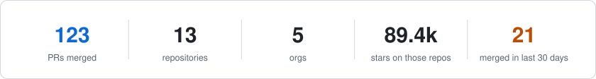
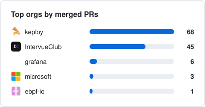
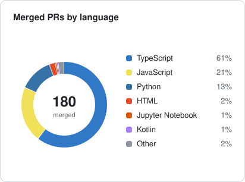
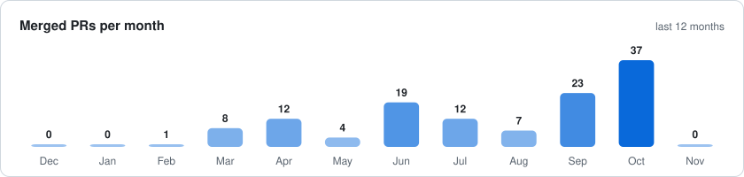

# 👨‍💻 Software Developer

  

<h1 align="center">Hi 👋, I'm Dhananjay</h1>
<h3 align="center">A passionate Full Stack Developer</h3>

- 🌱 I’m currently polishing **DSA and System Design**
- 💪🏼 Future Goals: Keep building cool things and learning fast
- 👯 Looking to collaborate on **creative full stack projects**
- 📫 Reach me at **dhananjay6561@gmail.com**
- ⚡ Fun fact: **"Don't know" is my actual username 😄**
- 
---

## 📊 Contributions, live

<picture><source media="(prefers-color-scheme: dark)" srcset="assets/summary-dark.svg"/><source media="(prefers-color-scheme: light)" srcset="assets/summary-light.svg"/></picture>
<picture><source media="(prefers-color-scheme: dark)" srcset="assets/orgs-dark.svg"/><source media="(prefers-color-scheme: light)" srcset="assets/orgs-light.svg"/></picture> <picture><source media="(prefers-color-scheme: dark)" srcset="assets/languages-dark.svg"/><source media="(prefers-color-scheme: light)" srcset="assets/languages-light.svg"/></picture>
<picture><source media="(prefers-color-scheme: dark)" srcset="assets/monthly-dark.svg"/><source media="(prefers-color-scheme: light)" srcset="assets/monthly-light.svg"/></picture>

Private repos and orgs included. Refreshed daily by a workflow in this repo.

### 🌍 Merged into

Click a logo to see the PRs. 
<!--MERGED:START-->
   
<!--MERGED:END-->

## 📊 GitHub Stats

<!--

  
   
  
   
  

-->

<!-- Enhanced GitHub Stats Cards -->

  
  

 

<!-- GitHub Summary Cards -->

  

 

  
  

 

  
  

---

## 🏅 **GitHub Activity & Achievements**

<!-- Activity Graph with Enhanced Styling -->

  

 

<!-- Streak Stats with Glow Effect -->

  

---

<!--START_SECTION:activity-->
<!-- This section will be automatically updated by GitHub Actions -->
<!--END_SECTION:activity-->

<!-- profile-counter.glitch.me visitor counter is dead (verified HTTP 410 Gone x3 on 2026-09-27) - commented out, not deleted -->
<!--  -->

