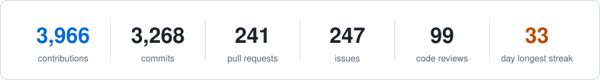
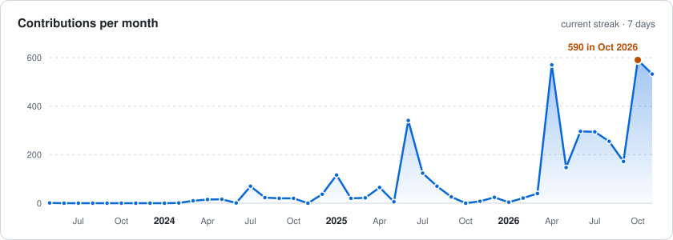
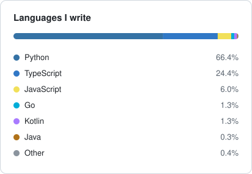
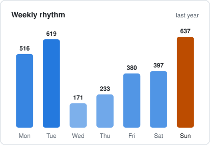
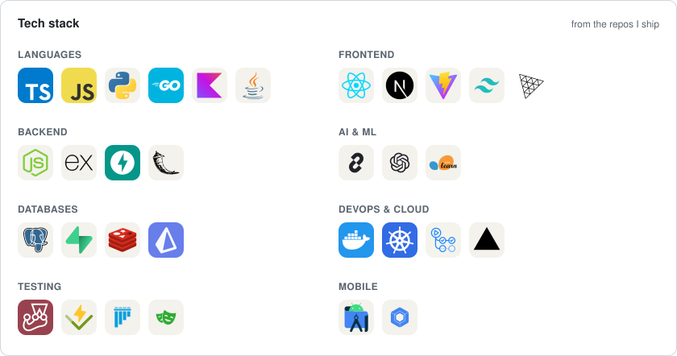

<a href="https://linktr.ee/Dj6561"><picture><source media="(prefers-color-scheme: dark)" srcset="assets/hero-dark.svg"/><source media="(prefers-color-scheme: light)" srcset="assets/hero-light.svg"/></picture></a>

## 🚧 Building right now

<a href="https://intervueclub.com"><picture><source media="(prefers-color-scheme: dark)" srcset="assets/project-intervueclub-dark.svg"/><source media="(prefers-color-scheme: light)" srcset="assets/project-intervueclub-light.svg"/></picture></a>
<a href="https://github.com/dhananjay6561/dot"><picture><source media="(prefers-color-scheme: dark)" srcset="assets/project-dot-dark.svg"/><source media="(prefers-color-scheme: light)" srcset="assets/project-dot-light.svg"/></picture></a>

<a href="https://github.com/dhananjay6561/design-md-hub"><picture><source media="(prefers-color-scheme: dark)" srcset="assets/project-design-md-hub-dark.svg"/><source media="(prefers-color-scheme: light)" srcset="assets/project-design-md-hub-light.svg"/></picture></a>
<a href="https://github.com/dhananjay6561/diskwhy"><picture><source media="(prefers-color-scheme: dark)" srcset="assets/project-diskwhy-dark.svg"/><source media="(prefers-color-scheme: light)" srcset="assets/project-diskwhy-light.svg"/></picture></a>

## 🤝 Let's connect

<a href="https://www.linkedin.com/in/dhananjay6561/"><picture><source media="(prefers-color-scheme: dark)" srcset="assets/social-linkedin-dark.svg"/><source media="(prefers-color-scheme: light)" srcset="assets/social-linkedin-light.svg"/></picture></a>
<a href="https://www.instagram.com/dhananjaydontknow"><picture><source media="(prefers-color-scheme: dark)" srcset="assets/social-instagram-dark.svg"/><source media="(prefers-color-scheme: light)" srcset="assets/social-instagram-light.svg"/></picture></a>

<a href="https://leetcode.com/u/dhananjay6561/"><picture><source media="(prefers-color-scheme: dark)" srcset="assets/social-leetcode-dark.svg"/><source media="(prefers-color-scheme: light)" srcset="assets/social-leetcode-light.svg"/></picture></a>
<a href="mailto:dhananjay6561@gmail.com"><picture><source media="(prefers-color-scheme: dark)" srcset="assets/social-email-dark.svg"/><source media="(prefers-color-scheme: light)" srcset="assets/social-email-light.svg"/></picture></a>

About me, projects and links in plain text

I'm **Dhananjay Aggarwal**, a full stack developer from Bangalore, India. I build web apps with Next.js and React, Android apps with Kotlin and Jetpack Compose, command-line tools in Go, and tooling for AI coding agents. I also break down one real AI tool a day in my **100 Days of AI** series on Instagram.

### Projects

- **[IntervueClub](https://intervueclub.com)**: free system design interview prep, with deep-written problems like WhatsApp, Ticketmaster, Dropbox and rate limiters, plus an HLD fundamentals course. Built with Next.js, Drizzle and Postgres.
- **[Dot](https://github.com/dhananjay6561/dot)**: a free, offline music player for Android and Nothing Phone, with Glyph lights that react to the music, beat-synced crossfade, a 10-band EQ and synced lyrics. Built with Kotlin and Jetpack Compose.
- **[design-md-hub](https://github.com/dhananjay6561/design-md-hub)**: 120 brand design systems as plain-text DESIGN.md specs for AI coding agents, reverse engineered from live production sites.
- **[diskwhy](https://github.com/dhananjay6561/diskwhy)**: a developer-focused CLI for disk analysis and cleanup, written in Go.

### Find me

[LinkedIn](https://www.linkedin.com/in/dhananjay6561/) · [Instagram](https://www.instagram.com/dhananjaydontknow) · [LeetCode](https://leetcode.com/u/dhananjay6561/) · [All links](https://linktr.ee/Dj6561) · [Email](mailto:dhananjay6561@gmail.com)

Fun fact: "Don't know" really is my username.

---

## 📊 Contributions, live

<picture><source media="(prefers-color-scheme: dark)" srcset="assets/summary-dark.svg"/><source media="(prefers-color-scheme: light)" srcset="assets/summary-light.svg"/></picture>
<picture><source media="(prefers-color-scheme: dark)" srcset="assets/orgs-dark.svg"/><source media="(prefers-color-scheme: light)" srcset="assets/orgs-light.svg"/></picture> <picture><source media="(prefers-color-scheme: dark)" srcset="assets/languages-dark.svg"/><source media="(prefers-color-scheme: light)" srcset="assets/languages-light.svg"/></picture>
<picture><source media="(prefers-color-scheme: dark)" srcset="assets/monthly-dark.svg"/><source media="(prefers-color-scheme: light)" srcset="assets/monthly-light.svg"/></picture>

Merged PRs into org repos, private ones included. Refreshed daily by a workflow in this repo.

### 🌍 Merged into

Click a logo to see the PRs. 
<!--MERGED:START-->
   
<!--MERGED:END-->

## 📈 GitHub stats

<picture><source media="(prefers-color-scheme: dark)" srcset="assets/lifetime-dark.svg"/><source media="(prefers-color-scheme: light)" srcset="assets/lifetime-light.svg"/></picture>
<picture><source media="(prefers-color-scheme: dark)" srcset="assets/monthly-contribs-dark.svg"/><source media="(prefers-color-scheme: light)" srcset="assets/monthly-contribs-light.svg"/></picture>
<picture><source media="(prefers-color-scheme: dark)" srcset="assets/langs-dark.svg"/><source media="(prefers-color-scheme: light)" srcset="assets/langs-light.svg"/></picture> <picture><source media="(prefers-color-scheme: dark)" srcset="assets/weekdays-dark.svg"/><source media="(prefers-color-scheme: light)" srcset="assets/weekdays-light.svg"/></picture>

Every contribution since May 2023, private repos included. Refreshed daily by the same workflow.

## 🛠️ Tech stack

<picture><source media="(prefers-color-scheme: dark)" srcset="assets/stack-dark.svg"/><source media="(prefers-color-scheme: light)" srcset="assets/stack-light.svg"/></picture>

---

<!--START_SECTION:activity-->
<!-- This section will be automatically updated by GitHub Actions -->
<!--END_SECTION:activity-->

<!-- profile-counter.glitch.me visitor counter is dead (verified HTTP 410 Gone x3 on 2026-09-27) - commented out, not deleted -->
<!--  -->

