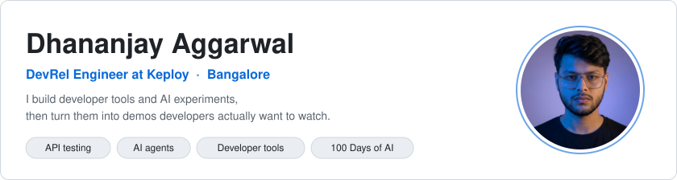

<picture><source media="(prefers-color-scheme: dark)" srcset="assets/header-dark.svg"/><source media="(prefers-color-scheme: light)" srcset="assets/header-light.svg"/></picture>

  <a href="https://www.linkedin.com/in/dhananjay6561/">LinkedIn</a> ·
  <a href="https://www.instagram.com/dhananjaydontknow">Instagram</a> ·
  <a href="https://leetcode.com/u/dhananjay6561/">LeetCode</a> ·
  <a href="https://linktr.ee/Dj6561">All links</a> ·
  <a href="mailto:dhananjay6561@gmail.com">dhananjay6561@gmail.com</a>

### ⚡ Right now

- 🧪 **DevRel at [Keploy](https://github.com/keploy/keploy)**: demos and short videos on API testing from real traffic (record and replay with eBPF, no code changes)
- 🤖 **100 Days of AI**: one real AI tool every day, broken down in a reel on [Instagram](https://www.instagram.com/dhananjaydontknow)
- 🎨 **[design-md-hub](https://github.com/dhananjay6561/design-md-hub)**: 120 brand design systems as plain-text DESIGN.md specs for AI coding agents
- 🧹 **[diskwhy](https://github.com/dhananjay6561/diskwhy)**: a Go CLI that finds what is eating your disk and cleans it up
- 😄 Fun fact: "Don't know" really is my username

---

## 📊 Contributions, live

<picture><source media="(prefers-color-scheme: dark)" srcset="assets/summary-dark.svg"/><source media="(prefers-color-scheme: light)" srcset="assets/summary-light.svg"/></picture>
<picture><source media="(prefers-color-scheme: dark)" srcset="assets/orgs-dark.svg"/><source media="(prefers-color-scheme: light)" srcset="assets/orgs-light.svg"/></picture> <picture><source media="(prefers-color-scheme: dark)" srcset="assets/languages-dark.svg"/><source media="(prefers-color-scheme: light)" srcset="assets/languages-light.svg"/></picture>
<picture><source media="(prefers-color-scheme: dark)" srcset="assets/monthly-dark.svg"/><source media="(prefers-color-scheme: light)" srcset="assets/monthly-light.svg"/></picture>

Merged PRs into org repos, private ones included. Refreshed daily by a workflow in this repo.

### 🌍 Merged into

Click a logo to see the PRs. 
<!--MERGED:START-->
   
<!--MERGED:END-->

## 📈 GitHub stats

<picture><source media="(prefers-color-scheme: dark)" srcset="assets/lifetime-dark.svg"/><source media="(prefers-color-scheme: light)" srcset="assets/lifetime-light.svg"/></picture>
<picture><source media="(prefers-color-scheme: dark)" srcset="assets/monthly-contribs-dark.svg"/><source media="(prefers-color-scheme: light)" srcset="assets/monthly-contribs-light.svg"/></picture>
<picture><source media="(prefers-color-scheme: dark)" srcset="assets/langs-dark.svg"/><source media="(prefers-color-scheme: light)" srcset="assets/langs-light.svg"/></picture> <picture><source media="(prefers-color-scheme: dark)" srcset="assets/weekdays-dark.svg"/><source media="(prefers-color-scheme: light)" srcset="assets/weekdays-light.svg"/></picture>

Every contribution since May 2023, private repos included. Refreshed daily by the same workflow.

## 🛠️ Tech stack

<picture><source media="(prefers-color-scheme: dark)" srcset="assets/stack-dark.svg"/><source media="(prefers-color-scheme: light)" srcset="assets/stack-light.svg"/></picture>

---

<!--START_SECTION:activity-->
<!-- This section will be automatically updated by GitHub Actions -->
<!--END_SECTION:activity-->

<!-- profile-counter.glitch.me visitor counter is dead (verified HTTP 410 Gone x3 on 2026-09-27) - commented out, not deleted -->
<!--  -->

