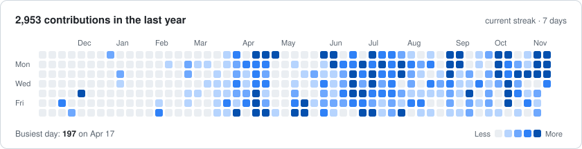

# 👨‍💻 Software Developer

  

<h1 align="center">Hi 👋, I'm Dhananjay</h1>
<h3 align="center">A passionate Full Stack Developer</h3>

- 🌱 I’m currently polishing **DSA and System Design**
- 💪🏼 Future Goals: Keep building cool things and learning fast
- 👯 Looking to collaborate on **creative full stack projects**
- 📫 Reach me at **dhananjay6561@gmail.com**
- ⚡ Fun fact: **"Don't know" is my actual username 😄**
- 
---

## 📊 Contributions, live

<picture><source media="(prefers-color-scheme: dark)" srcset="assets/summary-dark.svg"/><source media="(prefers-color-scheme: light)" srcset="assets/summary-light.svg"/></picture>
<picture><source media="(prefers-color-scheme: dark)" srcset="assets/orgs-dark.svg"/><source media="(prefers-color-scheme: light)" srcset="assets/orgs-light.svg"/></picture> <picture><source media="(prefers-color-scheme: dark)" srcset="assets/languages-dark.svg"/><source media="(prefers-color-scheme: light)" srcset="assets/languages-light.svg"/></picture>
<picture><source media="(prefers-color-scheme: dark)" srcset="assets/monthly-dark.svg"/><source media="(prefers-color-scheme: light)" srcset="assets/monthly-light.svg"/></picture>

Merged PRs into org repos, private ones included. Refreshed daily by a workflow in this repo.

### 🌍 Merged into

Click a logo to see the PRs. 
<!--MERGED:START-->
   
<!--MERGED:END-->

## 📈 GitHub stats

<picture><source media="(prefers-color-scheme: dark)" srcset="assets/lifetime-dark.svg"/><source media="(prefers-color-scheme: light)" srcset="assets/lifetime-light.svg"/></picture>
<picture><source media="(prefers-color-scheme: dark)" srcset="assets/calendar-dark.svg"/><source media="(prefers-color-scheme: light)" srcset="assets/calendar-light.svg"/></picture>
<picture><source media="(prefers-color-scheme: dark)" srcset="assets/langs-dark.svg"/><source media="(prefers-color-scheme: light)" srcset="assets/langs-light.svg"/></picture> <picture><source media="(prefers-color-scheme: dark)" srcset="assets/weekdays-dark.svg"/><source media="(prefers-color-scheme: light)" srcset="assets/weekdays-light.svg"/></picture>

Every contribution since May 2023, private repos included. Refreshed daily by the same workflow.

---

<!--START_SECTION:activity-->
<!-- This section will be automatically updated by GitHub Actions -->
<!--END_SECTION:activity-->

<!-- profile-counter.glitch.me visitor counter is dead (verified HTTP 410 Gone x3 on 2026-09-27) - commented out, not deleted -->
<!--  -->

